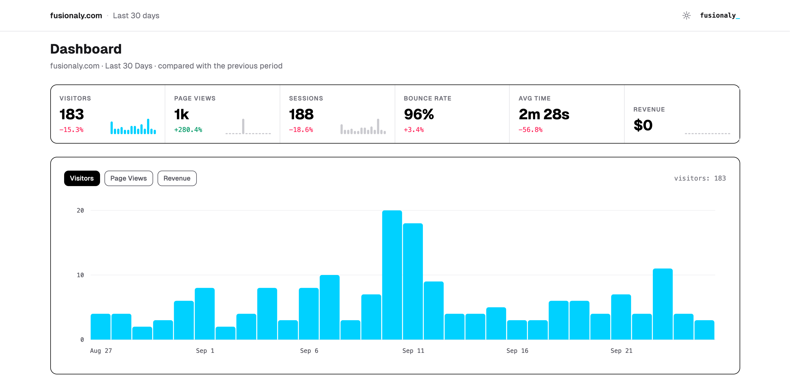

# Fusionaly

[](https://github.com/karloscodes/fusionaly-oss/actions/workflows/ci.yml) [](https://github.com/karloscodes/fusionaly-oss/releases/latest) [](https://hub.docker.com/r/karloscodes/fusionaly) [](LICENSE)

Self-hosted web analytics in one SQLite file.

See who visits, where they come from, and what they click. No cookies, no fingerprinting, no third parties. Fusionaly runs on a Raspberry Pi or a $5 VPS, on your own domain: one command installs it, and it updates itself every night. Ask it questions from Claude, Codex, Cursor, or Gemini.

**[Website](https://fusionaly.com)** · **[Docs](https://fusionaly.com/docs)** · **[Live dashboard](https://t.fusionaly.com/share/QdREgX5mZu5y)**

<a href="https://t.fusionaly.com/share/QdREgX5mZu5y">
  <picture>
    <source media="(prefers-color-scheme: dark)" srcset=".github/assets/dashboard-dark.png">
    
  </picture>
</a>

## Install

On your server, as root:

```bash
curl -fsSL https://fusionaly.com/install | sudo bash -s data.example.com
```

It installs [Chasen](https://chasenhq.com) (and Docker, when the server has none) and runs Fusionaly: HTTPS, live backups of the database, and an update each night. Run it again to update now.

From your computer instead:

```bash
curl -fsSL https://chasenhq.com/cli | sh
chasen deploy karloscodes/fusionaly --server root@203.0.113.5 --domain data.example.com --auto-update
```

Or run the image yourself: `karloscodes/fusionaly` on Docker Hub, or `ghcr.io/karloscodes/fusionaly`. Servers that the older installer set up keep working; to move one to Chasen, see [Move to Chasen](https://fusionaly.com/docs/move-to-chasen/). The full setup is in the [installation guide](https://fusionaly.com/docs/installation/).

> Don't host it on an `analytics.*` subdomain: ad blockers (uBlock Origin, EasyPrivacy) block hostnames like that and drop your tracking requests. Use a neutral subdomain such as `data.example.com`.

## Use

Add the script to your site:

```html
<script defer src="https://your-domain.com/y/api/v1/sdk.js"></script>
```

Page views and clicks are tracked automatically. For a named event, add one attribute to any element:

```html
<button data-fusionaly-event-name="signup_clicked">Sign up</button>
<a href="/pricing" data-fusionaly-event-name="pricing_viewed">Pricing</a>
<form data-fusionaly-event-name="contact_submitted">...</form>
<section data-fusionaly-event-name="testimonials_seen">...</section>
```

The SDK picks the right trigger for each element: click, submit, `sendBeacon`, or scroll into view. [Read the docs](https://fusionaly.com/docs/automated-tracking/).

## What you get

- **Tracking** - Page views, SPA navigation, clicks, forms, sections, revenue, and custom events. Automatic where it can be, one attribute where it can't.
- **Dashboard** - Visitors, sources, top pages, countries, devices, goals, and user flows. Daily charts follow your timezone, daylight saving included.
- **What's new** - A home feed across all your sites: traffic spikes and drops, new referrers, goal spikes, milestones. Each day is compared with the same weekday in past weeks, so a normal Monday peak is not news.
- **Ask from your AI client** - Claude, Codex, Cursor, or Gemini answer questions about your traffic in plain English. See [below](#ask-from-your-ai-client).
- **Annotations** - Mark deployments, campaigns, and incidents on the timeline.
- **Shareable dashboards** - Public, read-only links.
- **Bot filtering and spam protection** - Clean data by default.

## Privacy

- No cookies, no fingerprinting, no personal data stored.
- Visitors are counted with a hash that rotates daily, not a stable identifier.
- Everything stays on your server. No third parties, and Fusionaly never calls an AI provider.

## Ask from your AI client

Ask "where did my traffic come from this week?" in the AI client you already use. Fusionaly answers the Model Context Protocol at `/mcp` with four read-only tools, and the plugin adds a skill that turns questions into the right queries.

```
/plugin marketplace add karloscodes/fusionaly-oss
/plugin install fusionaly
/fusionaly:connect
```

That is Claude Code. Codex, Gemini CLI, Cursor, Claude Desktop, and others are one command each: see the [plugin README](plugin/README.md). Get the agent key from **Administration > Agents**. Your client asks your server, and only the answer reaches your AI provider. The tools can't write, and they can't read accounts, settings, or keys.

## Self-hosting

- One SQLite file. No external database, no Redis, no queue.
- Chasen sets up nightly updates and live backups, with no SSH chores. For off-server backups (VPS snapshots, Litestream, rsync), see [Backups](https://fusionaly.com/docs/server-administration/#backups).
- To run the image without Chasen, set `FUSIONALY_DOMAIN` and `FUSIONALY_PRIVATE_KEY` (at least 32 characters: `openssl rand -hex 32`). Chasen gives the key as `PRIVATE_KEY`, which Fusionaly reads too. [SDK configuration](https://fusionaly.com/docs/configuration/) has the tracking options.

## Development

Requirements: Go (the version in `go.mod`), Node.js 22 or later.

```bash
make install      # dependencies
make db-migrate   # migrations
make dev          # the dev server with hot reload, at http://localhost:3000
make test         # the unit tests
make test-e2e     # the Playwright end-to-end tests
make lint         # the linters
make build        # the production binaries
```

The code: `cmd/fusionaly` is the server, `cmd/fnctl` the admin CLI (migrations, accounts), and `cmd/manager` the older installer. `internal/` holds the core logic in Phoenix contexts, `api/v1/` the public tracking API and the SDK, `web/` the React frontend (Inertia.js, Tailwind), and `e2e/` the Playwright tests. Open an issue before a large change, and run `make lint`, `make test`, and `make test-e2e` before a pull request.

## License

MIT. See [LICENSE](LICENSE).
